# Order messaging with RabbitMQ

A producer publishes order events to a RabbitMQ queue. Worker processes consume them, acknowledging each message after processing.

## Architecture

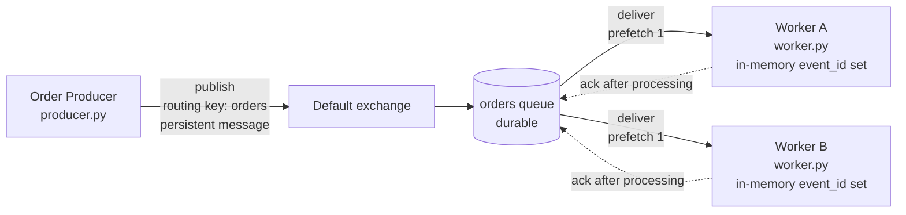

- The producer and the workers are separate processes. They only communicate through RabbitMQ.
- The producer publishes to the default exchange, which routes each message to the `orders` queue by name.
- Both workers consume from the same queue. Each message is delivered to only one of them (competing consumers).
- A message stays in the queue, as unacked, until the worker that received it acks it. If that worker dies first, RabbitMQ delivers the message to the other worker with `redelivered=True`.
- Each worker skips an `event_id` it has already processed, and acks the repeated message without doing the work again.

## Setup

Requires Docker and Python 3.10+. Run everything from the project root.

```
docker compose up -d                   # starts RabbitMQ
python3 -m venv .venv
source .venv/bin/activate
pip install -r requirements.txt
```

RabbitMQ listens for AMQP on port 5672. The management UI is at http://localhost:15672 (login `guest` / `guest`). `docker compose ps` should show the container as `healthy` before you start.

The producer and workers are separate processes. Each one runs in its own terminal with the venv active.

| Command | What it does |
|---|---|
| `python -u producer.py --num-messages N` | Publishes N new order events (default 10). `--start-order-id` sets the first `order_id`. |
| `python -u producer.py --event-id <id> --order-id <n>` | Publishes exactly one event with that `event_id`. Cannot be combined with `--num-messages`. |
| `python -u worker.py --name A` | Starts a worker. `--sleep S` sets the simulated work time per message (default 1). |
| `python -u worker.py --name A --crash-at received` | Failure injection: the worker exits without acking, either right after it receives a message (`received`) or after the work but before the ack (`processed`). |

Logs go to stderr. To save one to a file as well, append `2>&1 | tee <file>`.

## Successful message processing

One producer and one worker, with the worker started after the messages were published. The worker receives each order, logs it, does the work, and acks it.

```
# terminal 1: publish 5 orders (no worker is running yet)
python -u producer.py --num-messages 5
# terminal 2: start the worker afterwards
python -u worker.py --name A --sleep 1
```

The producer published all 5 orders at 13:28:01, and the worker did not start until 13:28:17. The messages waited in the queue until the worker connected, so neither process has to be running when the other one is. For each order the worker then logs `received`, `processed`, and `acked`, in that order. The ack is sent last, only after the work is finished. Logs: [producer.log](docs/evidence/successful-processing/producer.log), [worker-a.log](docs/evidence/successful-processing/worker-a.log).

```
13:28:01 [producer] published event_id=e08cb6bd-cdb5-4a98-afa4-e9af6481540e order_id=1 item_id=item-16 quantity=5
...
13:28:17 [worker A pid=60930] received event_id=e08cb6bd-cdb5-4a98-afa4-e9af6481540e order_id=1 redelivered=False
13:28:18 [worker A pid=60930] processed event_id=e08cb6bd-cdb5-4a98-afa4-e9af6481540e order_id=1 item_id=item-16 quantity=5
13:28:18 [worker A pid=60930] acked event_id=e08cb6bd-cdb5-4a98-afa4-e9af6481540e
```

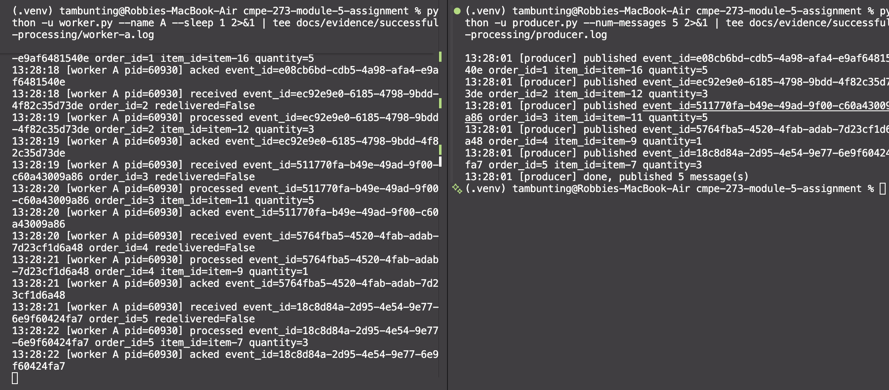

The worker log has 5 `received`, 5 `processed`, and 5 `acked` lines. Every `event_id` the producer published was acked, and no message was redelivered or flagged as a duplicate.

## Competing consumers

Two worker processes are attached to the **same** queue (`orders`). RabbitMQ gives each message to only one of them, so the workers share the load instead of each handling every message.

### How to reproduce

Use three terminals. Start both workers and wait for each to print `waiting for messages` before you publish.

```
# terminal 1
python -u worker.py --name A --sleep 0.5
# terminal 2
python -u worker.py --name B --sleep 0.5
# terminal 3
python -u producer.py --num-messages 10
```

For the slow/fast run, start the workers with `--sleep 3` (A) and `--sleep 0.2` (B) instead. Open the `orders` queue in the management UI (Queues, then `orders`) to see the Consumers table.

To check that no event was handled by both workers, save each worker's output (`2>&1 | tee a.log` and `2>&1 | tee b.log`) and run:

```
grep -h ' acked ' a.log b.log | grep -o 'event_id=[^ ]*' | sort | uniq -d
```

No output means no event was acked twice. The logs below were captured this way.

### Two consumers on one queue

The management UI shows two consumers attached to the `orders` queue. Each has its own channel and a prefetch count of 1.

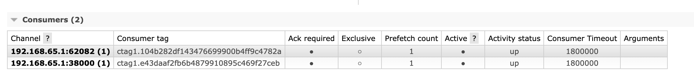

### Run 1: equal workers (10 messages, both `--sleep 0.5`)

The messages were split 5 and 5. Each worker handled different orders. The split isn't strictly alternating (A got orders 1, 3, 6, 7, 10 and B got 2, 4, 5, 8, 9), because a message goes to whichever worker has a free slot when it is dispatched.

Excerpt from each worker's log (full logs: [worker A](docs/evidence/competing-consumers/equal/worker-a.log), [worker B](docs/evidence/competing-consumers/equal/worker-b.log), [producer](docs/evidence/competing-consumers/equal/producer.log)):

```
19:05:00 [worker A pid=23921] received event_id=2d604e2d-c28e-4e64-a65a-36531117f862 order_id=1 redelivered=False
19:05:00 [worker A pid=23921] acked event_id=2d604e2d-c28e-4e64-a65a-36531117f862
19:05:00 [worker A pid=23921] received event_id=0c265b0d-9365-4787-ac38-84a4e21d3078 order_id=3 redelivered=False
...
19:05:00 [worker B pid=24090] received event_id=b46a19b3-ee30-45dd-a3aa-b08343778663 order_id=2 redelivered=False
19:05:00 [worker B pid=24090] acked event_id=b46a19b3-ee30-45dd-a3aa-b08343778663
19:05:00 [worker B pid=24090] received event_id=7b10c7bb-4b70-4ad9-8939-977bb20b5a02 order_id=4 redelivered=False
```

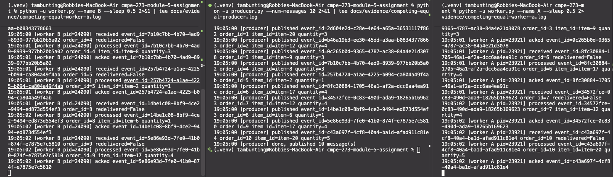

### Run 2: slow worker A, fast worker B (10 messages, `--sleep 3` and `--sleep 0.2`)

With `prefetch_count=1`, a worker only gets a new message after it acks the previous one. A spent 3 seconds on its first message, while B finished nine in the same time. The split was 1 and 9.

```
19:10:46 [worker A pid=30282] received event_id=f0712654-dbaa-4b0b-842e-f1506177f77f order_id=1 redelivered=False
19:10:49 [worker A pid=30282] processed event_id=f0712654-dbaa-4b0b-842e-f1506177f77f order_id=1 item_id=item-19 quantity=4
19:10:49 [worker A pid=30282] acked event_id=f0712654-dbaa-4b0b-842e-f1506177f77f
```

Worker A's log ends there. Full logs: [worker A](docs/evidence/competing-consumers/slowfast/worker-a.log), [worker B](docs/evidence/competing-consumers/slowfast/worker-b.log), [producer](docs/evidence/competing-consumers/slowfast/producer.log).

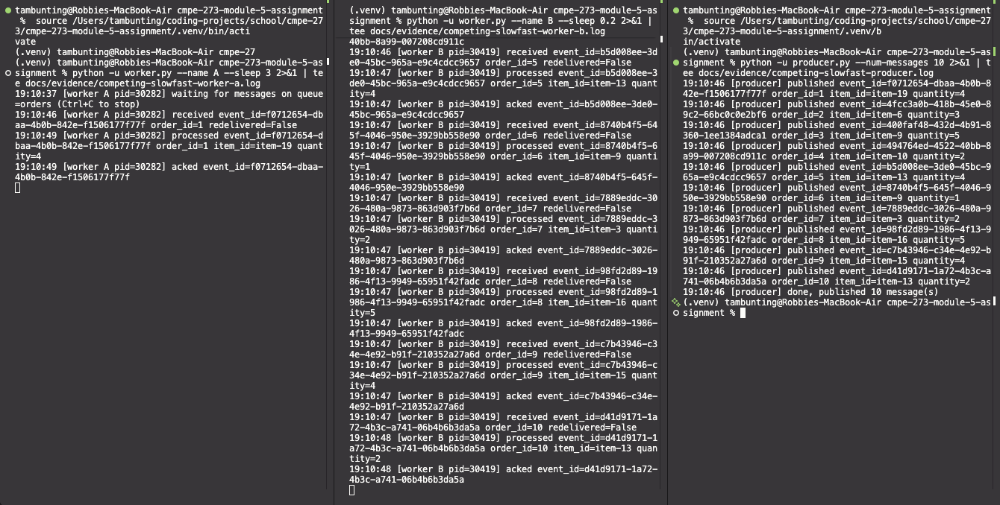

### Each message was handled by exactly one worker

For both runs, this command prints the `event_id`s that appear as acked in more than one worker's log. No output means no event was handled twice:

```
$ grep -h ' acked ' docs/evidence/competing-consumers/equal/worker-*.log | grep -o 'event_id=[^ ]*' | sort | uniq -d
$ grep -h ' acked ' docs/evidence/competing-consumers/slowfast/worker-*.log | grep -o 'event_id=[^ ]*' | sort | uniq -d
```

Both printed nothing. The set of acked `event_id`s also equals the set the producer published (10 of 10 in each run).

| Run | Worker A | Worker B | Duplicates |
|---|---|---|---|
| Equal (0.5s / 0.5s) | 5 | 5 | none |
| Slow/fast (3s / 0.2s) | 1 | 9 | none |

## Failure and redelivery

A worker receives a message and then dies before sending its ACK. RabbitMQ treats the message as not handled and delivers it to another worker.

### How the failure is produced

Worker A is started with `--crash-at received`. Right after it logs `received`, it calls `os._exit(1)`. This ends the process without any cleanup, so the broker sees the connection die as it would in a real crash. Worker B is started without the flag, so the crash depends on the worker and not on the message. B can handle the same message that crashed A.

Use four terminals. Start both workers and wait for `waiting for messages` in each.

```
# terminal 1: worker B (normal)
python -u worker.py --name B --sleep 1
# terminal 2: worker A (will crash)
python -u worker.py --name A --sleep 1 --crash-at received
# terminal 3: publish a batch; A crashes on its first message
python -u producer.py --num-messages 5
# after the crash, publish more to show the system is still up
python -u producer.py --num-messages 3 --start-order-id 100
```

In the management UI, the Consumers table shows 2 consumers before the crash and 1 after it.

> **Where the evidence comes from:** the screenshots are from one run of these steps, and the text logs are from a second run, so the `event_id`s differ. The first run's terminal output was not saved to files.

### 1. Before the crash: two consumers

Both workers are connected to the `orders` queue.

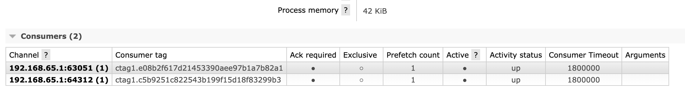

### 2. The crash and the redelivery

Left to right in the screenshot: the producer, worker B, and worker A. Worker A receives `b78fdaf1…` (order 2) with `redelivered=False`, logs `CRASH injected`, and exits without acking. Worker B then receives the **same** `event_id` and `order_id` with `redelivered=True`, processes it, and acks it.

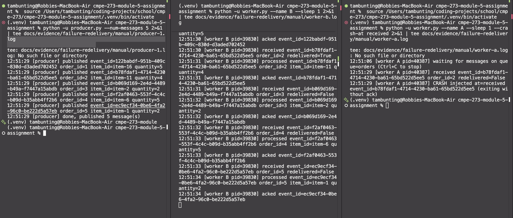

The same sequence from the second run's logs ([worker A](docs/evidence/failure-redelivery/crash-at-received/worker-a.log), [worker B](docs/evidence/failure-redelivery/crash-at-received/worker-b.log)):

```
19:27:34 [worker A pid=37664] received event_id=21b83af8-dfce-49be-a38c-cb00f4b4baaa order_id=2 redelivered=False
19:27:34 [worker A pid=37664] CRASH injected at=received event_id=21b83af8-dfce-49be-a38c-cb00f4b4baaa (exiting without ack)
19:27:35 [worker B pid=37665] received event_id=21b83af8-dfce-49be-a38c-cb00f4b4baaa order_id=2 redelivered=True
19:27:36 [worker B pid=37665] processed event_id=21b83af8-dfce-49be-a38c-cb00f4b4baaa order_id=2 item_id=item-18 quantity=4
19:27:36 [worker B pid=37665] acked event_id=21b83af8-dfce-49be-a38c-cb00f4b4baaa
```

Worker A's log ends at the `CRASH` line, with no `acked` line. The message was never acknowledged, so the broker put it back in the queue and gave it to B.

### 3. After the crash: one consumer, empty queue

The broker now shows one consumer, and 0 Ready and 0 Unacked. Worker A's connection is gone, and the redelivered message was acked by B, so nothing is left in the queue.

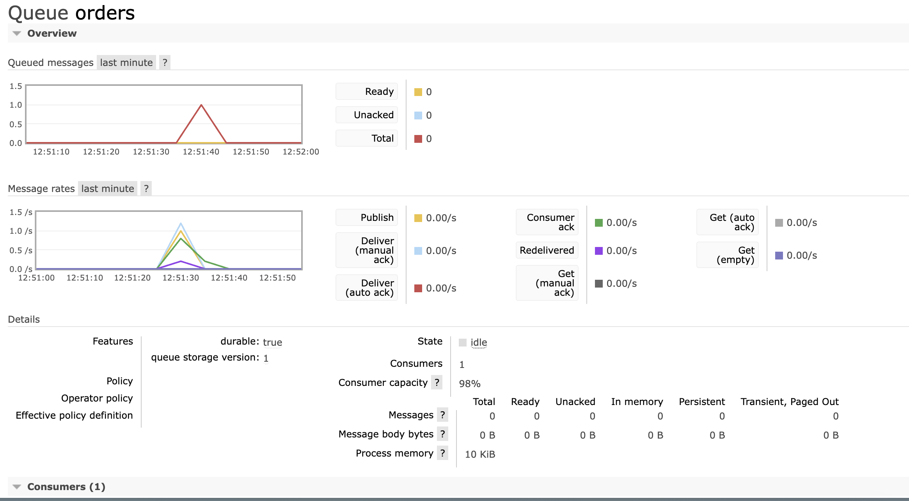

### 4. The system keeps running

The producer and the broker were not affected, and worker B kept running. After the crash, the producer published three more messages (orders 100 to 102):

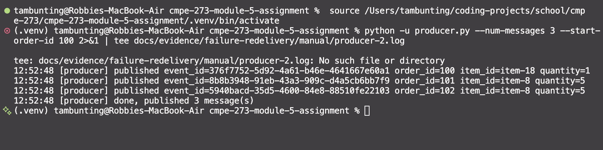

This screenshot shows the producer still publishing after the crash. Worker B handling those messages is shown in the second run's log:

```
19:27:37 [worker B pid=37665] received event_id=cfef3c56-eedb-4cbb-811c-ba3836e922c0 order_id=100 redelivered=False
19:27:38 [worker B pid=37665] processed event_id=cfef3c56-eedb-4cbb-811c-ba3836e922c0 order_id=100 item_id=item-17 quantity=1
19:27:38 [worker B pid=37665] received event_id=6143db9d-cf63-4f84-a164-2e41e1fb3474 order_id=101 redelivered=False
19:27:38 [worker B pid=37665] processed event_id=6143db9d-cf63-4f84-a164-2e41e1fb3474 order_id=101 item_id=item-15 quantity=5
19:27:38 [worker B pid=37665] received event_id=35631122-0ce3-4438-b375-2f7d356ceab7 order_id=102 redelivered=False
19:27:39 [worker B pid=37665] processed event_id=35631122-0ce3-4438-b375-2f7d356ceab7 order_id=102 item_id=item-4 quantity=2
```

Queue states recorded during the second run ([queue-states.txt](docs/evidence/failure-redelivery/crash-at-received/queue-states.txt)):

```
before publishing:    ready=0 unacked=0 consumers=2
after the crash+drain: ready=0 unacked=0 consumers=1
```

| | Worker A | Worker B |
|---|---|---|
| Messages acked | 0 | 8 |

All 8 published events were acked exactly once, including the one that crashed worker A.

### What this shows

When a worker's connection closes while it holds an unacked message, RabbitMQ puts the message back in the queue and marks it `redelivered=True`. The next worker with a free slot receives it. In this run, worker A crashed **before** doing any work (`--crash-at received`), so the order was processed once, by B. If a worker crashed *after* the work but before the ack, the same redelivery would happen and the work would be done twice, which is the duplicate-handling case.

## Duplicate handling

Each worker keeps an in-memory set of the `event_id`s it has already processed. When a message arrives with an `event_id` that is in the set, the worker logs `DUPLICATE`, skips the business action, and acks the message so the broker deletes the copy. A new `event_id` is added to the set after the work finishes and before the ack. If the worker crashed before that point, the message is redelivered and the work repeats, so an order is never silently skipped.

### How to reproduce

Use one worker and one producer terminal. Pick any fixed `event_id`; publishing it twice simulates a producer retry.

```
# terminal 1
python -u worker.py --name A --sleep 0.5
# terminal 2, run each command separately
python -u producer.py --event-id 5f0c1e2a-7b3d-4c8e-9a41-0d2e6b7f8a13 --order-id 50
python -u producer.py --event-id 5f0c1e2a-7b3d-4c8e-9a41-0d2e6b7f8a13 --order-id 50
```

### The producer sends the same event twice

Both commands publish the same `event_id` and `order_id` ([producer-first-publish.log](docs/evidence/duplicate-handling/producer-duplicate/producer-first-publish.log), [producer-second-publish.log](docs/evidence/duplicate-handling/producer-duplicate/producer-second-publish.log)).

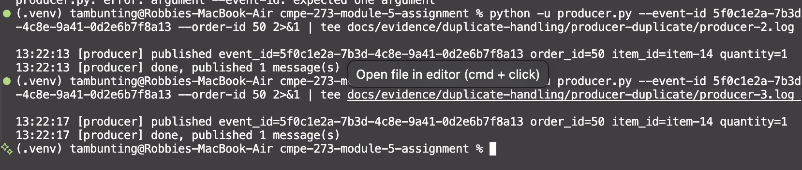

### The worker detects the duplicate

The first copy is processed and acked. The second copy is detected, the business action is skipped, and the message is acked. Full log: [worker-a.log](docs/evidence/duplicate-handling/producer-duplicate/worker-a.log).

```
13:22:13 [worker A pid=56896] received event_id=5f0c1e2a-7b3d-4c8e-9a41-0d2e6b7f8a13 order_id=50 redelivered=False
13:22:13 [worker A pid=56896] processed event_id=5f0c1e2a-7b3d-4c8e-9a41-0d2e6b7f8a13 order_id=50 item_id=item-14 quantity=1
13:22:13 [worker A pid=56896] acked event_id=5f0c1e2a-7b3d-4c8e-9a41-0d2e6b7f8a13
13:22:17 [worker A pid=56896] received event_id=5f0c1e2a-7b3d-4c8e-9a41-0d2e6b7f8a13 order_id=50 redelivered=False
13:22:17 [worker A pid=56896] DUPLICATE event_id=5f0c1e2a-7b3d-4c8e-9a41-0d2e6b7f8a13 order_id=50 redelivered=False, skipping business action
13:22:17 [worker A pid=56896] acked event_id=5f0c1e2a-7b3d-4c8e-9a41-0d2e6b7f8a13 (duplicate)
```

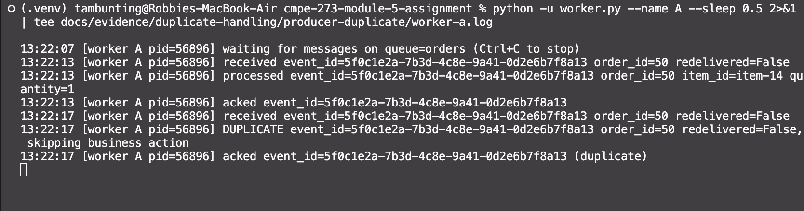

For this event, the log has one `processed` line and one `DUPLICATE` line.

Both copies arrived with `redelivered=False`. The broker had never delivered either one before, so the flag could not have flagged the second copy. Only the application-level `event_id` can.

### Limitation of the in-memory set

The set lives inside one worker process, so it protects against duplicates only when the same worker sees the same `event_id` again. It does not catch:

- two copies of an event that are delivered to different workers,
- an event that A processed and then crashed before acking, when it is redelivered to B (B's set is empty),
- a duplicate that arrives after the worker restarted, because the set is lost.

To cover those cases, the record of processed events has to be shared and durable, for example a file with a lock or a database table with a unique constraint on `event_id`, written in the same transaction as the business action.

